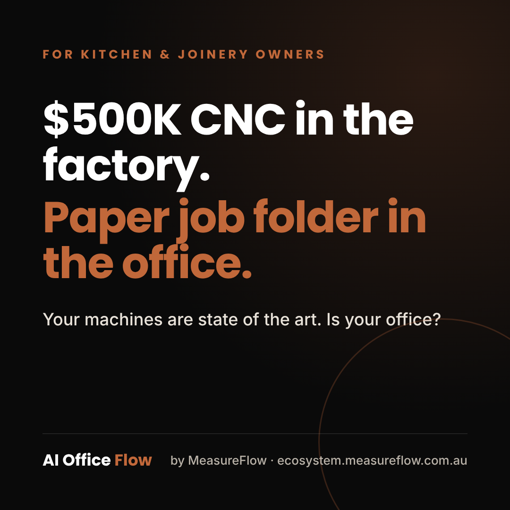
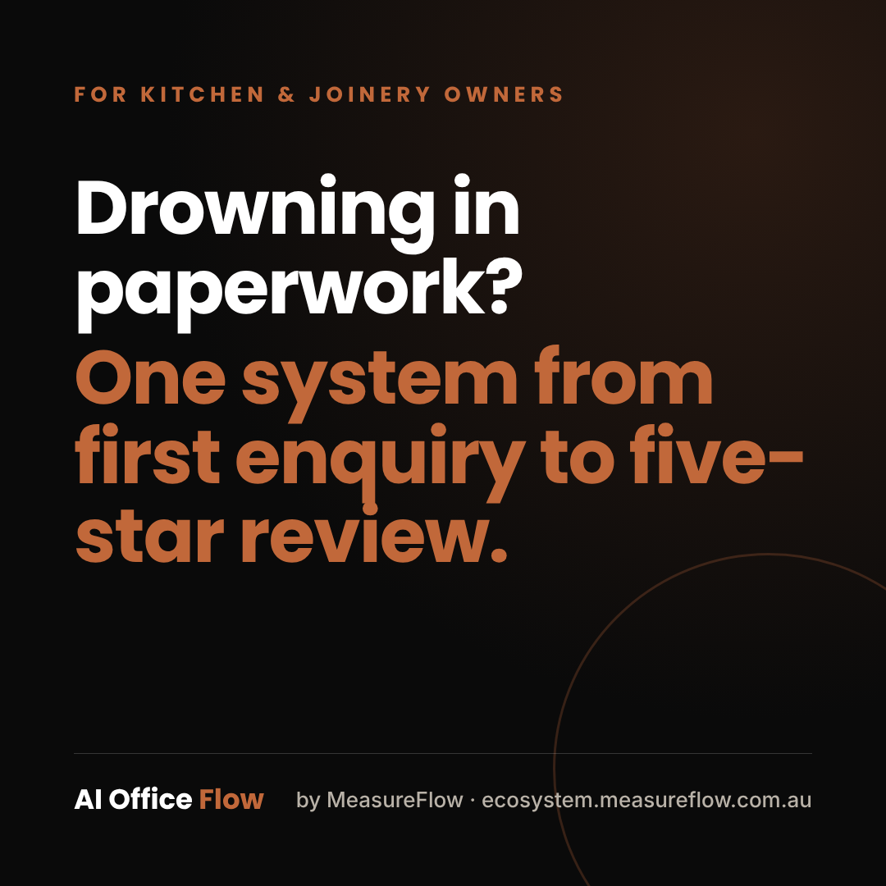
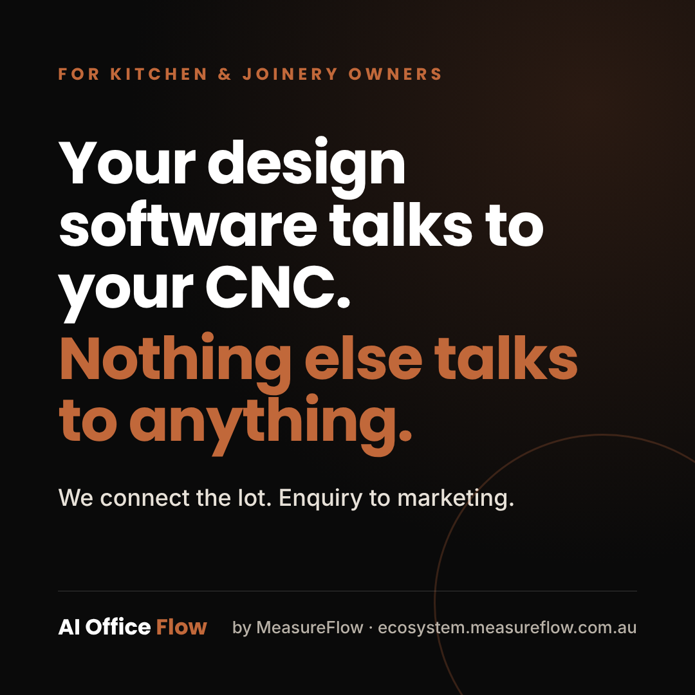
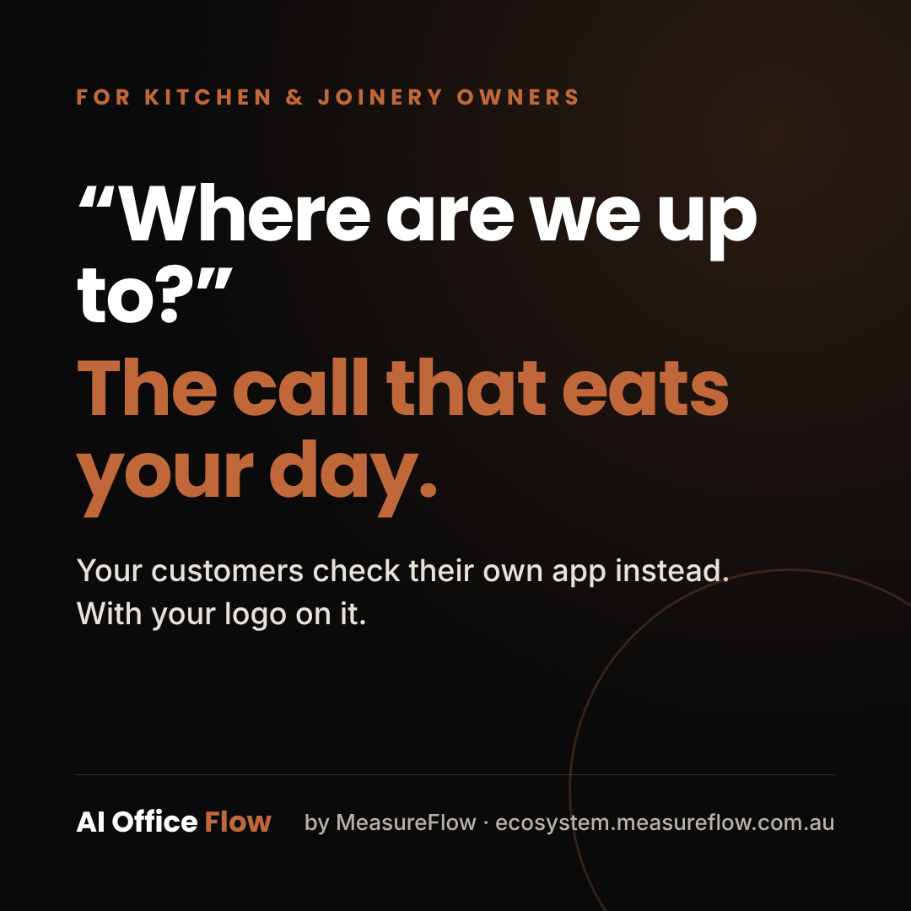
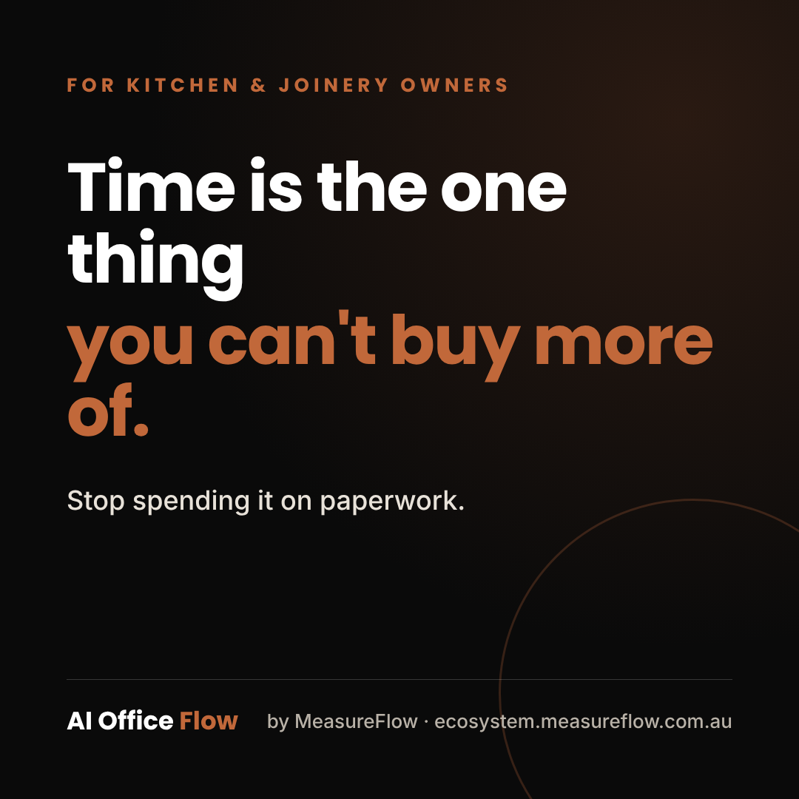
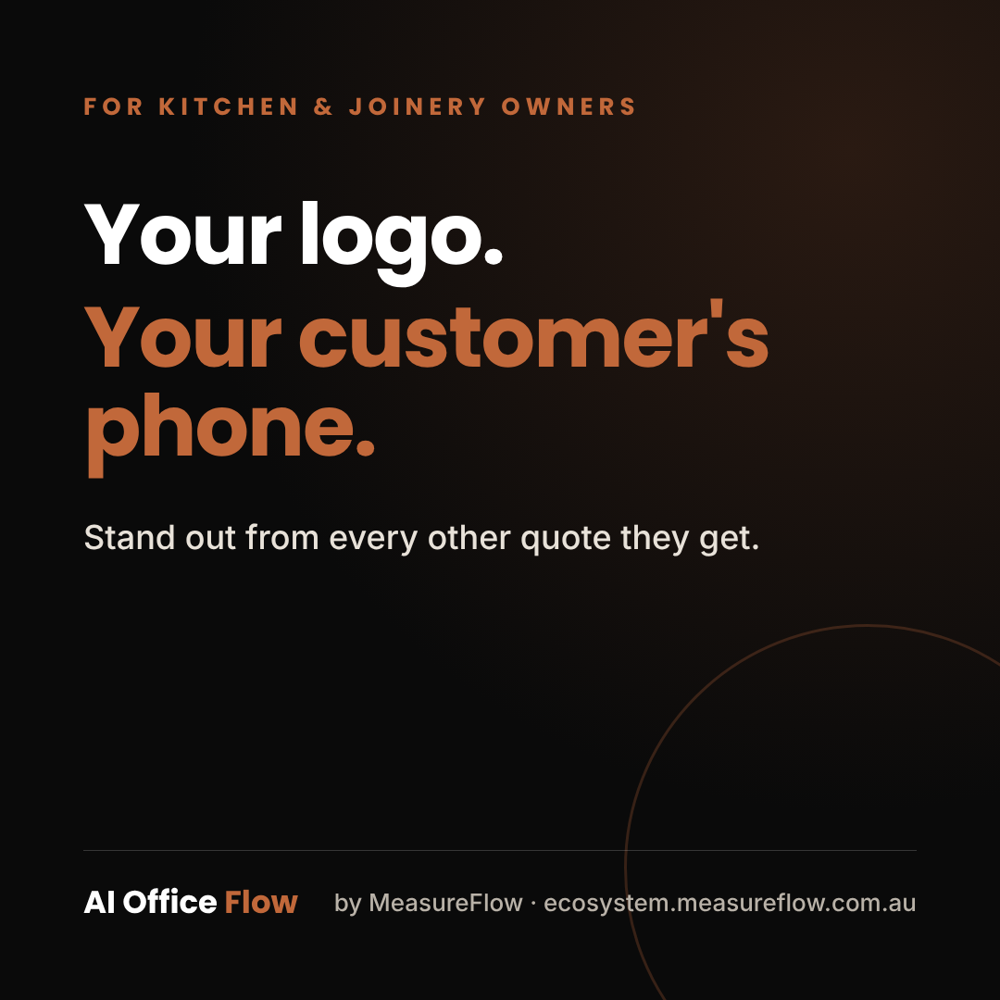
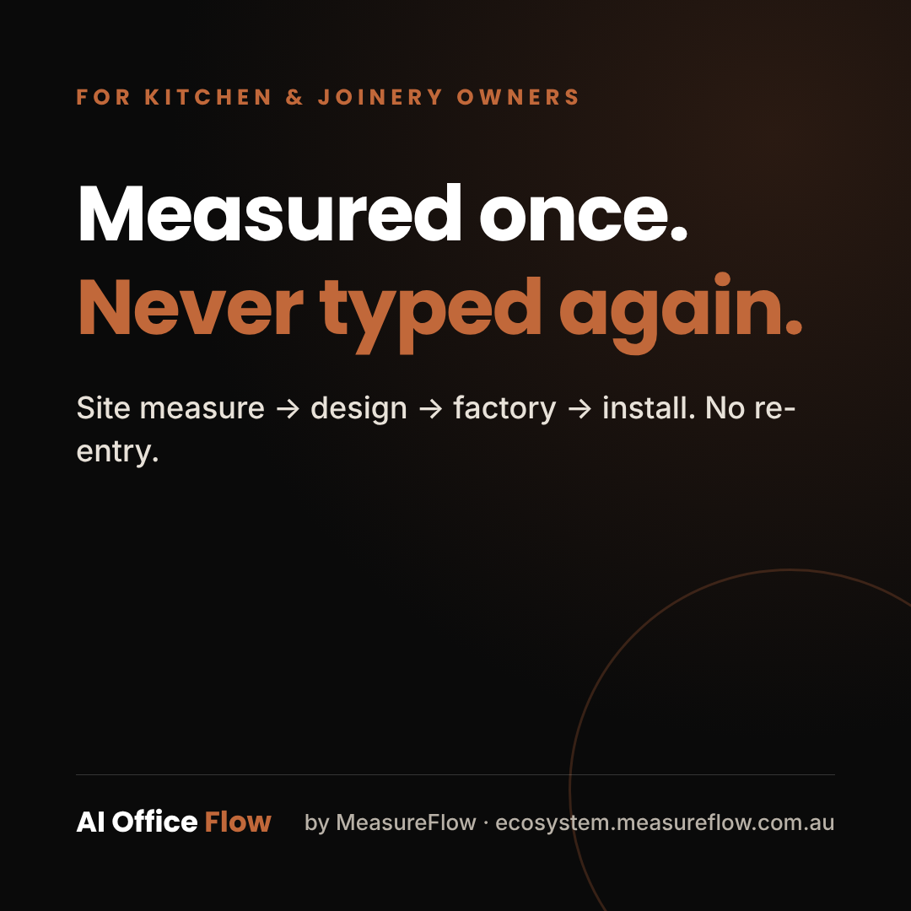
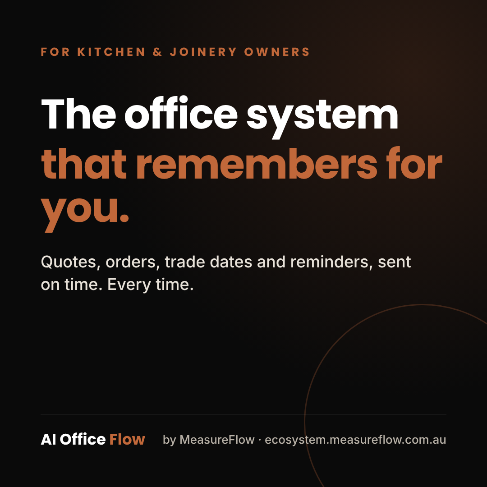
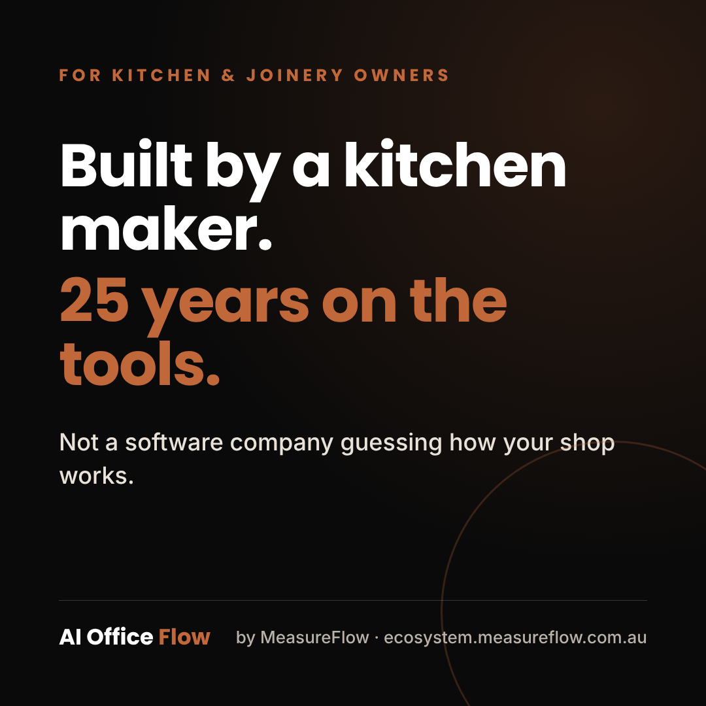
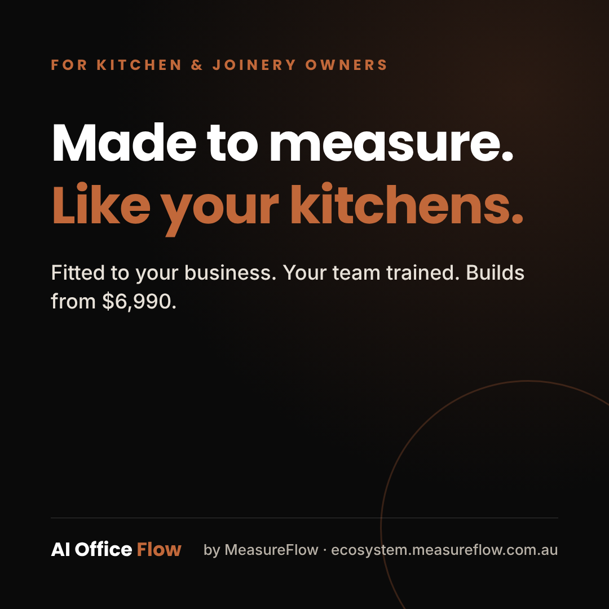

**How the tracking works:** every link below is tagged with the post it came from. When someone clicks, the website records which post sent them (and which group, if you change `utm_campaign` to the group name, e.g. `utm_campaign=cabinet-makers-melbourne`). The Meta Pixel adds every clicker to the retargeting audience, so we can show them ads later. Bookings arrive at accounts@ showing the post and group.

## 1. $500K CNC in the factory. Paper job folder in the office.

{width=55%}

**Caption:** Walk through most kitchen factories and you'll see a CNC worth more than a house. Walk into the office and it's job folders, a whiteboard and a phone that won't stop. We fix the office side, so it runs as well as the factory.

**Link:** `https://ecosystem.measureflow.com.au/?source=fb-group&utm_source=facebook&utm_medium=group&utm_campaign=cabinet-maker-groups&utm_content=cnc-vs-paper`

## 2. Drowning in paperwork? One system from first enquiry to five-star review.

{width=55%}

**Caption:** Quotes, orders, cutting lists, install dates, invoices, the texts in between. If it lives on paper or in someone's head, it gets lost. AI Office Flow puts the lot in one place, built around how your shop already works.

**Link:** `https://ecosystem.measureflow.com.au/?source=fb-group&utm_source=facebook&utm_medium=group&utm_campaign=cabinet-maker-groups&utm_content=drowning-paperwork`

## 3. Your design software talks to your CNC. Nothing else talks to anything.

{width=55%}

**Caption:** Signing, design and the machines are digital. Everything in between is paper and phone calls. We join it up: enquiry, quote, signing, design, factory, install, care and reviews. One system, in your business's name.

**Link:** `https://ecosystem.measureflow.com.au/?source=fb-group&utm_source=facebook&utm_medium=group&utm_campaign=cabinet-maker-groups&utm_content=nothing-talks`

## 4. “Where are we up to?” The call that eats your day.

{width=55%}

**Caption:** Every kitchen business knows that call. Customers want to know when the stone's coming and when the installers turn up. Give them an app with your logo and the answer's already there.

**Link:** `https://ecosystem.measureflow.com.au/?source=fb-group&utm_source=facebook&utm_medium=group&utm_campaign=cabinet-maker-groups&utm_content=where-are-we-up-to`

## 5. Time is the one thing you can't buy more of.

{width=55%}

**Caption:** You can buy another machine. You can't buy back the nights spent doing quotes and chasing paperwork. The system does the chasing, so you get your evenings back.

**Link:** `https://ecosystem.measureflow.com.au/?source=fb-group&utm_source=facebook&utm_medium=group&utm_campaign=cabinet-maker-groups&utm_content=time`

## 6. Your logo. Your customer's phone.

{width=55%}

**Caption:** When a client is comparing three quotes, be the one with your own app: their plans, their dates, who's arriving when, all under your brand. It's what won our first big sale.

**Link:** `https://ecosystem.measureflow.com.au/?source=fb-group&utm_source=facebook&utm_medium=group&utm_campaign=cabinet-maker-groups&utm_content=your-logo`

## 7. Measured once. Never typed again.

{width=55%}

**Caption:** How many times does the same measurement get written down in your business? On site, in the design, on the cutting list, on the install sheet. Capture it once and let it flow through.

**Link:** `https://ecosystem.measureflow.com.au/?source=fb-group&utm_source=facebook&utm_medium=group&utm_campaign=cabinet-maker-groups&utm_content=measured-once`

## 8. The office system that remembers for you.

{width=55%}

**Caption:** Customers get reminded about selections and payments. Trades get reminded when they're due on site. Nothing relies on someone remembering. It just happens.

**Link:** `https://ecosystem.measureflow.com.au/?source=fb-group&utm_source=facebook&utm_medium=group&utm_campaign=cabinet-maker-groups&utm_content=remembers`

## 9. Built by a kitchen maker. 25 years on the tools.

{width=55%}

**Caption:** I ran a kitchen business for over 25 years. I built the system I wish I'd had. It fits how kitchen and joinery shops actually run, because I've run one.

**Link:** `https://ecosystem.measureflow.com.au/?source=fb-group&utm_source=facebook&utm_medium=group&utm_campaign=cabinet-maker-groups&utm_content=built-by-kitchen-maker`

## 10. Made to measure. Like your kitchens.

{width=55%}

**Caption:** You build kitchens made to measure. Your office system should be too. We fit it to how your business already works, and we train your staff on the system and on using AI. Builds start at $6,990. Support plans start at $199 a month.

**Link:** `https://ecosystem.measureflow.com.au/?source=fb-group&utm_source=facebook&utm_medium=group&utm_campaign=cabinet-maker-groups&utm_content=made-to-measure`

## Posting plan
- One post per group per week, rotating groups so no group sees the same post twice.
- Best times: early morning (6-7am) or evening (7-9pm) when owners check their phones.
- Reply to every comment the same day - comments push the post up in the group.
- Tell this chat which group you posted in; the team logs it and reports clicks and bookings per post on Fridays.